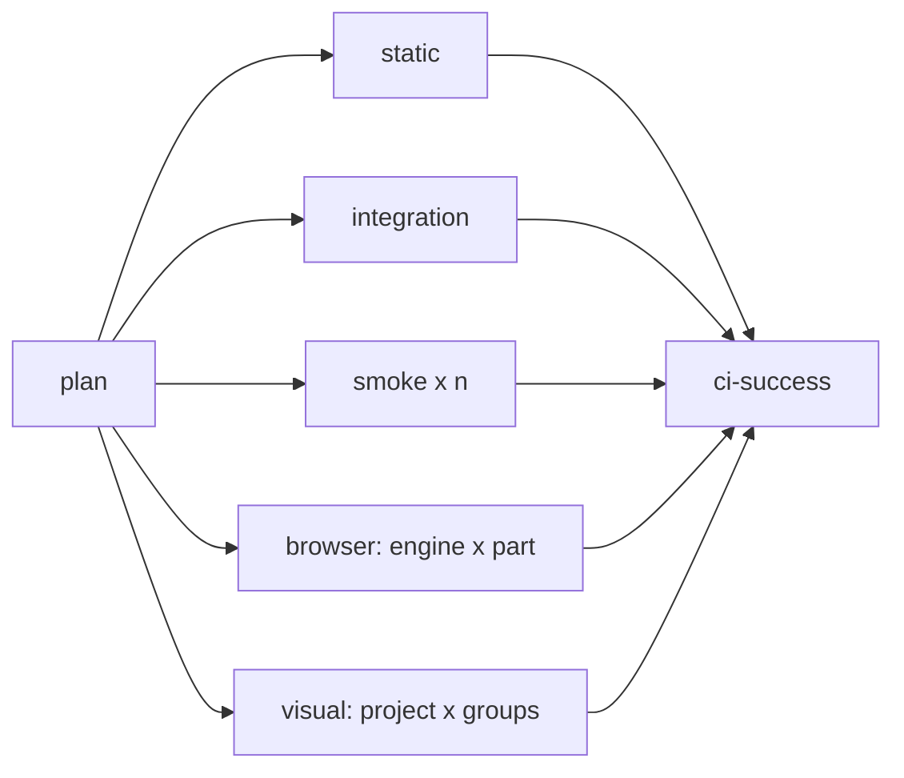

# Continuous Integration

**Scope:** the GitHub Actions workflows that check, render, and publish the repository: their jobs, how work is split and parallelized, how setup is shared, what decides which jobs run, and the time budgets that keep it fast as the library grows.
**Code:** `.github/workflows/ci.yml`, `.github/workflows/visual.yml`, `.github/workflows/update-visual-baselines.yml`, `.github/workflows/docs.yml`, `.github/actions/setup/`, `scripts/ci-matrix.ts`, `scripts/merge-baselines.ts`, `packages/testing/src/ci.ts`, `vitest.ts`, `playwright.ts`, `packages/core/test/browser/fixtures/groups.ts`, `packages/core/test/visual/tags.ts`.

## 1. Goals

1. **Fast feedback.** A pull request learns whether it is formatted, linted, typed, and builds within 2 minutes, and gets a full result within 5.
2. **Scales with the library.** Twice the components adds jobs, not minutes to each job. No job's duration depends on the total number of components.
3. **One required check.** Branch protection requires `ci-success` alone, so jobs can be added, split, or removed without touching repository settings.
4. **One place for each decision.** Setup is written once, the matrices are generated once, and the visual jobs are defined once for checking and for updating baselines.
5. **Every failure is legible.** A failing job names what failed (an engine, a gallery group, a gate) and keeps going in its siblings, so one run shows every failure.

## 2. Principles

- **Split by what a job needs.** A job installs only what it uses: no browser for static checks, one engine for an engine's tests, the pinned container only for pixels. **Why:** a browser install with system packages costs 20–50s per job, and a container start 35–55s, more than most checks take.
- **Parallelize along gallery groups.** The gallery groups (`foundation`, `inventory`, `production`, `shell`, `forms`, `inputs`, `navigation`, `data`, `overlays`, and any added later) are the unit of splitting for every suite that renders the gallery: visual, axe, reflow, strings, and the locales checks. **Why:** they already organize the baselines and the workbench, a new component family becomes a new group, and a failing job then names its group. A count-based shard (`--shard=2/3`) moves tests between jobs whenever one is added and names nothing.
- **Select tests before fixtures.** A job lists only the tests it runs, through tags and `grep` (Playwright) or environment-selected groups (Vitest). A test never calls `test.skip()` from its body to opt out of a project. **Why:** Playwright creates the `page` fixture before the test body runs, so a skipped test still opens and closes a page, about a second each in Firefox. At 846 skipped tests per job that was most of the job.
- **Generate matrices; never hand-edit them.** A `plan` job computes every matrix from the groups and test counts.
- **Rebuild rather than pass artifacts** when the build is cheaper than an upload and download. **Why:** `npm run build` takes about 11s; moving `dist/` folders between jobs costs more and couples jobs. Artifacts are for outputs a person or a later workflow needs (reports, baselines, the site).
- **Fail late.** No matrix fails fast, and `ci-success` reports every job.
- **Budgets, not hope.** Every job has a target duration and a hard timeout (§9). When a job outgrows its target, the matrix splits it; the target is not raised.

## 3. Topology

| Job           | Needs  | Runs                                                                                                                                                                                          | Installs      |
| ------------- | ------ | --------------------------------------------------------------------------------------------------------------------------------------------------------------------------------------------- | ------------- |
| `plan`        |        | `scripts/ci-matrix.ts`: the matrices for `smoke`, `browser`, and `visual`, and which job families the change affects (§7)                                                                     | Node only     |
| `static`      |        | `check:toolchain`, `format:check`, `lint`, `build` (which also runs `check:locales`), `typecheck`, `check:contrast`, `check:strings`, `check:api`, `test:node`, `check:package`, `check:size` | Node only     |
| `integration` | `plan` | `build`, `check:consumer`, `check:frameworks`                                                                                                                                                 | Chromium      |
| `smoke`       | `plan` | `build`, then `test:smoke` for its part of the workbench entries                                                                                                                              | Chromium      |
| `browser`     | `plan` | `test:browser` for one engine and one part (§5)                                                                                                                                               | That engine   |
| `visual`      | `plan` | `test:visual` for one project and a set of groups, in the pinned Playwright image                                                                                                             | The container |
| `ci-success`  | all    | Fails if any job failed or was cancelled, or was skipped when `plan` said it should run                                                                                                       | None          |

- `static` does not wait for `plan`, so the fastest feedback starts at once. It runs `build` before `typecheck`, and no typecheck script builds anything itself.
- `integration` is separate from `static` because it is the only non-browser work that needs a browser.
- The visual jobs run inside `mcr.microsoft.com/playwright:v<version>-noble`, with `<version>` the installed `@playwright/test`, and `HOME=/root`, because GitHub starts container jobs with a `$HOME` owned by another user and Firefox then refuses to launch as root ([testing.md §6](testing.md)).
- A failing visual job uploads its report as `visual-report-<project>-<part>`.

## 4. Shared setup

`.github/actions/setup` is a composite action that every job in every workflow uses after `actions/checkout`:

- `actions/setup-node` with `node-version-file: .nvmrc` and the npm cache;
- `npm ci`;
- with a `browsers` input (`chromium`, `firefox`, `webkit`, or a list), the Playwright browsers restored from a cache keyed by the installed Playwright version and the engine, then `npx playwright install --with-deps` for those engines, which then only installs the system packages;
- with `build: true`, `npm run build`.

**Why:** setup is the same six lines in ten jobs and three workflows today, and a change to it (a cache key, a Node flag) has to be made in each.

## 5. Splitting the suites

### 5.1 Groups as data

The list of gallery groups lives in a data module with no DOM or Lit imports, `packages/core/test/browser/fixtures/groups.ts`, read by the gallery, the visual spec, the gallery suites, and `scripts/ci-matrix.ts`. Each group lists its component names; the gallery maps them to markup.

Theme names are read from the token source (`packages/core/src/tokens/themes.ts`, which Node can load), never written in a workflow or the matrix script, so renaming, adding, or removing a theme changes CI with no edit to it.

### 5.2 Visual

- **Tags.** Each visual test carries `@group:<name>` and `@theme:<name>`, and `@cross-engine` or `@forced` when those projects run it. Each Playwright project selects its tests with `grep`: `firefox` and `webkit` take `@cross-engine`, `chromium-forced` takes `@forced`, and `chromium` takes everything. A job adds `--grep` for its groups, and for its themes when it has been split by theme (§6).
- **Matrix.** `chromium` runs one job per group. `chromium-forced`, `firefox`, and `webkit` run their reduced sets, packed into as few jobs as the budget allows (§9), each job a set of whole groups.
- **ARIA snapshots** (`aria.spec.ts`) are tagged by group like the screenshots and split the same way.
- **Workers.** Each job runs 4 workers, one per vCPU of a GitHub runner ([testing.md §6](testing.md)).

### 5.3 Browser suites

- **Component tests** (`src/**/*.test.ts`, and the files of `test/browser` that are not gallery suites) are split by family across the parts of an engine: a component's folder is one family, and any other file is a family of its own. `PUNK_BROWSER_PART=<n>/<total>` runs every total-th family, from the n-th, so a family's files stay together.
- **Gallery suites** (`a11y`, `reflow`, `overlays-a11y`, and the locales `apply` test) read `PUNK_GALLERY_GROUPS` and `PUNK_GALLERY_THEMES` and render only those groups and themes, so each part takes whole groups, or a group's themes when it has been split by theme (§6). In a part, a suite runs only when the part names groups. The locales test renders the default theme, so a part whose themes leave it out skips its gallery checks. `strings` runs whole with the component tests: it takes a second, and its check that every exemption is used needs every component.
- **Combinations by engine.** Chromium runs every theme, density, and content variant in the gallery suites. Firefox and WebKit run the default theme with compact density and `light` with low density, as the visual matrix does. **Why:** the gallery suites grow with components times 32 combinations in every engine; engine differences show in layout and behavior, which the component tests cover in all three, not in the palette.
- **Files run one after another inside a part.** Vitest's file parallelism shares one browser's focus between files, and many tests depend on focus; parallelism comes from parts, not from files.

### 5.4 Smoke

- Entries are checked through a pool of 4 pages, and a page is ready when Storybook reports it rendered, not after a fixed wait.
- The scripted flows (the application shell, the examples, the guides) run after the pool, one at a time.
- `PUNK_SMOKE_PART=<n>/<total>` selects a deterministic slice of entries, and the flows run in the first part only. `plan` raises the part count when the entry count passes the budget.

## 6. Matrix generation

`scripts/ci-matrix.ts` writes the matrices as JSON outputs of the `plan` job, consumed with `fromJSON`. It reads the groups (§5.1), the number of visual tests per group and project (`playwright test --list`), the component test files, and the workbench entry count (`storybook index`, which needs no build), and packs them into jobs by a per-job cost cap (§9):

- each unit's cost is its test count times a per-engine weight, kept in the script beside the cap;
- the unit is a group. When a group alone exceeds the cap in a project that renders every theme (`chromium`, and the Chromium gallery suites), it is split into one unit per theme, named for both ("chromium · shell · high-contrast");
- units are packed greedily, largest first, and a unit is never split across jobs;
- a group-and-theme unit that alone exceeds the cap is reported as a failure of `plan`, since it means the group should be split into two groups, not into shards.

A Node test covers the packing. The browser parts are packed the same way, from the size of each group rather than a listing: a group costs its components times the theme and density pairs the engine renders, times a measured cost per pair, and an engine has at least a fixed number of parts for its component tests. **Why:** when components double, new groups and longer lists produce more jobs automatically. Theme is the second axis, not the first: the number of themes does not grow with components, each visual job costs a container start, and most projects render only one or two themes, so a theme dimension on every job would add mostly setup. As a fallback it keeps a large group in one place in the gallery while still naming what failed, and only a group too large even per theme is caught as a design problem.

## 7. What runs

- **Change detection.** `plan` compares the change with its base (the first parent of the pull request's merge commit): a change limited to `specs/**`, `*.md` outside the workbench, or `.github/dependabot.yml` runs only `static`. Every other change runs everything. A push to `main` always runs everything.
- **`ci-success`** accepts a skipped job only if `plan` skipped it on purpose; a failed, cancelled, or unexpectedly skipped job fails it.
- **Superseded runs.** A `concurrency` group keyed on the pull request cancels an older run when a newer commit arrives. Runs on `main` are never cancelled.

## 8. Other workflows

- **Visual jobs are one reusable workflow,** `visual.yml` (`workflow_call`), with a `mode` input of `check` or `update`. `ci.yml` calls it with `check`. `update-visual-baselines.yml` calls it with `update` on the same matrix, and each job uploads its groups' baselines as an artifact, merged into one artifact to commit. The update workflow takes optional `groups` and `themes` inputs (all by default): a palette change in one theme re-renders only that theme's baselines in each group. The baselines being rendered are deleted first, so baselines of removed tests do not linger, and those outside the inputs are kept. `scripts/merge-baselines.ts` does the merge; it reads a baseline's theme from its file name, and a capture named for no theme belongs to the default theme, as its test's tag says. **Why:** rendering every baseline in one job grows with every component, two definitions of the visual matrix would drift, and a change to one theme should not rewrite every other theme's files.
- **Docs** (`docs.yml`) builds and deploys the workbench on a push to `main` and runs no tests ([workbench.md §8](workbench.md)).

## 9. Budgets

| Job                              | Target, including setup | Timeout    |
| -------------------------------- | ----------------------- | ---------- |
| `plan`                           | 1 minute                | 10 minutes |
| `static`                         | 2 minutes               | 10 minutes |
| `integration`, each `smoke` part | 3 minutes               | 10 minutes |
| each `browser` part              | 4 minutes               | 15 minutes |
| each `visual` job                | 4 minutes               | 15 minutes |
| the whole run                    | 5 minutes               |            |

The packing cap of §6 is set so a packed job meets its target. The `plan` job writes the slowest jobs of the last successful run on `main` to its summary, against their targets, so a job creeping toward its target is seen before it misses it. A job that misses its target is split by the matrix, or its suite is made cheaper; the target stays. Jobs outside this table (`ci-success`, the baseline merge, the docs jobs) have a timeout of 5 or 10 minutes.

## Verification

- `ci-success` is the required check on `main`.
- `packages/testing/test/ci.test.ts` covers the planning that `scripts/ci-matrix.ts` runs: packing, the split by theme, the oversized-unit failure, selections, change detection, and the budget report. `merge-baselines.test.ts` covers what a selection replaces and keeps.
- `packages/testing/test/visual-ci.test.ts` fails if any workflow pins a Playwright image other than the installed version.
- The budgets of §9 are reported, not asserted; a missed target is visible in the `plan` summary.

## Gaps

None in the design. The packing caps and costs in `scripts/ci-matrix.ts` are estimates from a few CI runs, and are corrected as the `plan` summary shows real job times.
