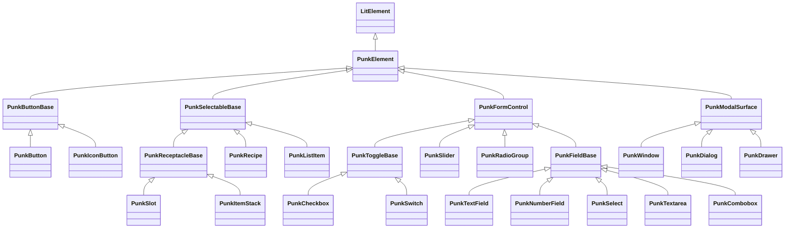

# Component Model

**Scope:** how a component is built: its files, its base class, the controllers and pure modules it uses, how it treats properties and attributes, what it may write to its host and its children, and how components cooperate without depending on each other.
**Code:** `src/internal/`, `src/components/*/`, `src/utilities/register-element.ts`, `src/utilities/warn.ts`.

## 1. Anatomy

```text
src/components/<entry>/
  <name>.ts                    the class: properties, render, behavior
  <name>.styles.ts             its static styles, composed from shared style modules
  <name>-<logic>.ts            optional pure logic used only by this component (for example meter-state.ts)
  index.ts                     re-exports the class(es) and types; declares HTMLElementTagNameMap entries
  register.ts                  registerElement(tag, class) for each tag of the family
  <name>.test.ts               browser tests
  <name>.registration.test.ts  the class entry defines nothing; register.ts defines the family
  <name>.reduced-motion.test.ts  only when the component has motion (testing.md §4)
```

A family (tabs, accordion, toast) keeps every tag in one directory with one `register.ts`.

## 2. `PunkElement`

Every component extends `PunkElement`, which extends `LitElement` and provides:

- the shared base styles: `box-sizing: border-box`, `:host([hidden]) { display: none !important }`, font and color from tokens;
- `emit(name, detail?)`, which dispatches a bubbling, composed `CustomEvent` ([package-contract.md §5](package-contract.md));
- the replacement of a server-rendered shadow root when the element upgrades, with the shared sheets adopted and focus and typed text kept ([ssr.md §4](ssr.md)), and the hook through which `@dieselpunk/core/hydrate.js` hydrates it instead ([ssr.md §5](ssr.md)).

Every component renders into an open shadow root. A component whose focus target is a native control inside it sets `delegatesFocus: true`.

## 3. Base classes

Shared behavior lives in abstract bases in `src/internal/`. A component extends the narrowest base that fits, and a base exists only when two or more components share it.



| Base                 | Owns                                                                                                                      | Spec                                                      |
| -------------------- | ------------------------------------------------------------------------------------------------------------------------- | --------------------------------------------------------- |
| `PunkButtonBase`     | Native inner button, variants and sizes, disabled and loading, form submit and reset, external ARIA, roving item          | [layout-and-actions.md §4](layout-and-actions.md)         |
| `PunkSelectableBase` | Host-level widget role and tab stop, Enter and Space activation, `punk-activate`, `aria-pressed`, being managed by a grid | [inventory-and-readouts.md §1](inventory-and-readouts.md) |
| `PunkReceptacleBase` | The square receptacle markup, size, highlighted, invalid, badge, overlay                                                  | [inventory-and-readouts.md §1](inventory-and-readouts.md) |
| `PunkFormControl`    | Form association, validity, reset and restore, `touched`, names from labels                                               | [forms.md §1](forms.md)                                   |
| `PunkToggleBase`     | Checked state, toggling by click and keys, host role and state                                                            | [forms.md §6](forms.md)                                   |
| `PunkFieldBase`      | A native control in the shadow tree, label, hint, message, ARIA on the inner control                                      | [forms.md §8](forms.md)                                   |
| `PunkModalSurface`   | `<dialog>`, `open`, heading, `ModalController`, open and close events, scroll region, footer                              | [overlays.md §6](overlays.md)                             |

All other components extend `PunkElement` directly.

## 4. Controllers

Reusable behavior that is not an "is a" relation is a Lit reactive controller:

| Controller         | Does                                                                                                     | Used by                                                                            |
| ------------------ | -------------------------------------------------------------------------------------------------------- | ---------------------------------------------------------------------------------- |
| `SlotPresence`     | Whether a named or default slot has content (non-blank text counts), checked on connect and `slotchange` | panel, divider, recipe, and others with optional strips                            |
| `LocaleWatcher`    | Re-renders its host once when the message locale changes                                                 | every component whose render calls `msg()` ([localization.md §3](localization.md)) |
| `RovingController` | One tab stop and arrow-key focus among items                                                             | toolbar ([keyboard-and-selection.md §2](keyboard-and-selection.md))                |
| `ModalController`  | Opening a `<dialog>`, initial focus, focus return, scroll lock, Escape                                   | window, dialog ([overlays.md §3](overlays.md))                                     |

A controller adds and removes its listeners in `hostConnected` and `hostDisconnected`. A field that holds a controller only so it is constructed may be otherwise unused.

## 5. Pure logic

Logic that can be stated without the DOM is a pure module with no DOM types, tested under Node with no browser ([testing.md §2](testing.md)). It follows the Node-run syntax rules ([toolchain.md §3](toolchain.md)). The component holds the DOM half and calls it.

| Module                                 | Decides                                                                     |
| -------------------------------------- | --------------------------------------------------------------------------- |
| `internal/selection-model.ts`          | Single and multiple selection, anchors, ranges                              |
| `internal/grid-navigation.ts`          | The next slot for a key, from item rectangles                               |
| `internal/roving-keys.ts`              | The next enabled index for a key in a one-dimensional group                 |
| `internal/tab-navigation.ts`           | Tab focus and selection for a key, in automatic and manual activation       |
| `internal/overlay-stack.ts`            | The Escape stack, bound to a target by `overlays.ts`                        |
| `internal/window-position.ts`          | Clamping a window to the viewport, centering on a point, keyboard steps     |
| `internal/slider-math.ts`              | Ranges, snapping without drift, keys and pointer positions to values, ticks |
| `internal/toast-timer.ts`              | A pausable countdown with an injected clock                                 |
| `internal/stat-format.ts`              | A stat's shown and full value, change, and trend                            |
| `components/meter/meter-state.ts`      | The HTML meter algorithm, clamping, and segments                            |
| `utilities/position.ts`                | Anchored placement: flip, shift, and fallback                               |
| `utilities/number-format.ts`           | Number and percent formatting for a language                                |
| `components/pagination/page-window.ts` | Which pages a pagination shows, and where the gaps are                      |

**Why:** these are where off-by-one, rounding, and direction bugs live, and a Node test can enumerate every case in milliseconds.

## 6. Properties and attributes

- Properties are declared with `@property` (public) or `@state` (private). Public ones follow [package-contract.md §4](package-contract.md).
- **Order does not matter.** A property set before the element is defined, before it connects, or after; and an attribute added, changed, or removed: each yields the same result.
- **Repair, do not throw.** An invalid value is repaired and rendered: an unknown enumerated value is the default, a number out of range is clamped, a non-finite number is the default or "none" as the component says, an inconsistent range is replaced by a valid one. Each repair warns once per occurrence in development ([package-contract.md §6](package-contract.md)). Removing an attribute restores the default silently.
- **Accessors where "set" matters.** When behavior depends on whether a property was ever set (a slot's `selected`, which turns on `aria-pressed`) or on other properties at read time (a slider's `value`, which is clamped to the current range when read), the property is an accessor over a stored raw value.
- **Converters** for attributes that need them (a default-true boolean, a number that may be empty) are shared in `internal/converters.ts`.

## 7. What a component writes to its host

- **Roles, `tabindex`, and ARIA states of a host-level widget are host attributes**, not `ElementInternals` properties. **Why:** they then reach every assistive technology the same way, and DOM-reading tools (axe, Playwright's role engine, application tests) see what users get.
- **The author's values win.** A component adds `tabindex` only when the author set none, and removes only what it added. A role set by the author before a component took it over (the status light's and stat's `announce`) is remembered and given back.
- **`aria-label` is not written onto a host as a name**: names come from rendered text ([accessibility.md §3](accessibility.md)). The exceptions are listed there.
- A component writes nothing to `document.documentElement` except the modal scroll lock ([overlays.md §3](overlays.md)), and nothing to `document.body`. The one stylesheet it adds outside its own shadow roots is the table's, adopted once into the root that holds a table, scoped to tables inside `punk-table`, and at zero specificity ([data-display.md §1](data-display.md)).

## 8. Owners and children

Several containers manage light-DOM children they do not render: the slot grid its items, tabs their tabs and panels, the accordion its items, the toolbar its items, the toast stack its toasts, the radio group its radios, the toggle group its buttons, the list its items, the breadcrumb its items, the table its sortable header cells, and the fieldset the controls it disables.

- **The owner owns the shared state.** The child never changes it alone. A grid sets its items' `selected`, role, `tabindex`, and `aria-selected`; tabs set their tabs' selection and their panels' role, `aria-labelledby`, `hidden`, and `tabindex`; the stack sets its toasts' `slot`.
- **Children are found on `slotchange`**, never by observing the DOM. A child that is not yet defined is waited for with `customElements.whenDefined`. A child that upgrades after the owner rendered gets no `slotchange`, so it announces itself to its owner when it connects.
- **Children tell their owner,** not the other way round. A child holds an `owner` reference, set by the owner, and calls it when something the owner depends on changes (disabled, value, selected, expanded). The owner coalesces these into one update per microtask.
- **Everything is given back.** When a child leaves or the owner disconnects, every attribute the owner wrote is restored to what the author had.
- **One protocol.** The owner and child roles are one generic protocol in `internal/owner.ts`: an `[owner]` slot on the child, set and cleared by its owner; a single `[childChanged](child, changed)` notification with Lit's changed properties; and `[release](child)`, which the owner runs when a child leaves its slot and a child runs itself when it disconnects (a toast). Its `Ledger` is the restore bookkeeping: it remembers each attribute's value before the owner's first write and the elements the owner disabled, and gives back exactly those. Owners of plain elements (the toggle group's buttons, the breadcrumb's items, the table's header cells, the fieldset's controls, the tabs' panels) use the ledger alone. Each owner implements only what it does with a change.
- **Protocol members are private to the library**, keyed by symbols from `internal/` and marked `@internal`, so neither the manifest nor the API snapshot lists them ([package-contract.md §9](package-contract.md)). The symbols have no description, which keeps their bytes out of each entry. Lit's decorators do not receive a symbol key from the development transform, so a child creates its `[owner]` property with `createProperty` in a static block.

## 9. Composition

- **No component renders another `punk-` component in its shadow tree**, with one exception: the icon button renders a `punk-tooltip` as its visible label, and its register entry registers the tooltip. Everything else that looks shared (close and dismiss buttons, status shapes, field frames, readout plates, receptacles) is a shared style module and native markup, so registration entries stay independent.
- **Shared style modules** (`styles/`) are imported by each component that uses them and counted in each entry's size ([performance.md §2](performance.md)).
- **Shared logic** is a base class, a controller, or a pure module, never a component.
- Components compose through slots and events in the application's markup. A container never assumes which components its children are beyond the item protocol it documents.

## 10. Rendering rules

- `render()` reads no layout (`getBoundingClientRect`, `offsetWidth`, `getComputedStyle`) and starts nothing asynchronous.
- `msg()` is called in `render()` and nowhere else, so a message is read when it is drawn.
- Styles are static and adopted: every instance of a class shares the same `CSSStyleSheet` objects, and no template contains a `<style>`.
- A shadow tree has a fixed number of elements for a component's configuration; no value, label, or status adds elements (lists of children are the application's).
- Setting a property to the value it has does not render.
- Module evaluation has no side effects other than defining classes, except in `register.ts`. A module-level state that must exist (the overlay stack, the tooltip warm-up window, the locale watcher's set) is created lazily and has a reset hook for tests where tests need one.
- Listeners on `document` or `window` exist only while needed (an overlay is open, a drag is in progress, a countdown is running), with the one locale listener as the only permanent exception ([performance.md §3](performance.md)).

## 11. Slots and slotted text

- A slot that is visually hidden but must keep reporting its content is rendered inside a `hidden` wrapper, never omitted, because assignment and `slotchange` do not depend on rendering.
- Text read from slotted content (a remove button's name, a field's external label) is read on `slotchange` or connect, not in `render()`. Such text is not live, and the component offers a property (`remove-label`, `label`) for content that changes without a slot change.
- Ids for ARIA relationships inside one tree come from `uid(prefix)`, and ids the author set are kept.

## Verification

- Each component's `*.test.ts`: both directions of every property, repairs and their warnings, ownership restoration, and the rendering rules that apply to it.
- `*.registration.test.ts` for each entry.
- `test/browser/perf*.test.ts`: fixed element counts, shared sheets, no render on an unchanged value, no layout read in render, listeners only while needed ([performance.md](performance.md)).
- `check:package`: no register entry brings another family.
- Node tests for every module in §5.

## Gaps

None.
